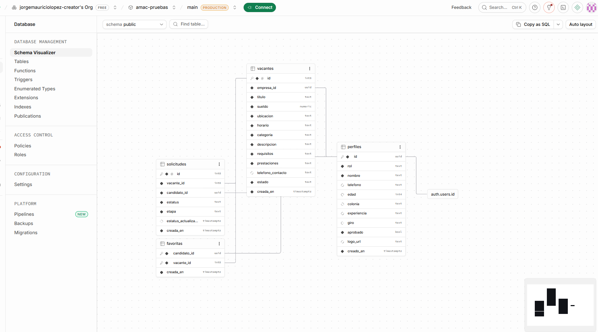
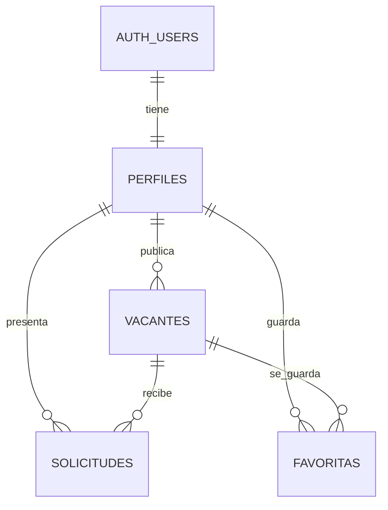

# AMAC · Bolsa de trabajo

Entrega 3 del proyecto de Desarrollo de Aplicaciones Web. La aplicación usa
React, Vite, React Router y Supabase. Conserva el diseño, el logo y los estilos
de la [Entrega 2](https://github.com/salro07co-ux/amac-web).

[Aplicación publicada en Vercel](https://amac-react-nu.vercel.app/)

## Integrantes y aportaciones

- **Mauricio López** preparó la base del proyecto en React y Vite, la navegación, las rutas protegidas, el contexto de sesión y las pantallas de registro, acceso y recuperación. Agregó la reescritura de rutas de Vercel. [Base y acceso](https://github.com/jorgemauriciolopez-creator/amac-react/commit/d926283), [rutas en Vercel](https://github.com/jorgemauriciolopez-creator/amac-react/commit/be55a58)
- **Salvador Rodríguez Coronado** desarrolló el flujo del candidato, desde la búsqueda de vacantes hasta sus solicitudes y favoritas. Agregó los estilos y el logo. [Flujo candidato](https://github.com/jorgemauriciolopez-creator/amac-react/commit/f984b46), [estilos](https://github.com/jorgemauriciolopez-creator/amac-react/commit/45f0b5d)
- **Axel Machorro** desarrolló las pantallas de empresa y administración, la conexión con Supabase y los scripts del esquema y de los datos de prueba. [Pantallas de empresa y administración](https://github.com/jorgemauriciolopez-creator/amac-react/commit/d4dd4bd), [esquema y datos de prueba](https://github.com/jorgemauriciolopez-creator/amac-react/commit/1c44e9e)

## Ejecutar en local

Usa Node.js 22.12 o superior.

```bash
npm install
npm run dev
```

El repositorio incluye el archivo de bloqueo de pnpm. Si usas ese gestor,
ejecuta `pnpm install` y `pnpm dev`.

### Demostración local

En desarrollo, si no hay variables de Supabase, la app carga seis vacantes
ficticias y guarda los cambios en el navegador. La sesión se mantiene por
pestaña. La demostración permite recorrer los flujos sin un servidor de base
de datos y usa una clave fija para entrar.

| Perfil | Correo ficticio |
| --- | --- |
| Candidato aprobado | candidato@amac.test |
| Candidato pendiente | pendiente@amac.test |
| Empresa | empresa@amac.test |
| Administrador | admin@amac.test |

Clave de demostración para las cuatro cuentas: `AmacDemo2026`.

### Conectar Supabase

1. En un proyecto de pruebas nuevo, ejecuta `supabase/esquema.sql` en SQL Editor.
2. Copia `.env.example` a `.env.local` y llena `VITE_SUPABASE_URL` y
   `VITE_SUPABASE_PUBLISHABLE_KEY` con los valores del proyecto. Reinicia Vite.
   Git ignora `.env.local`.
3. En la configuración de URL de Supabase Auth, permite el destino
   `http://127.0.0.1:5173/restablecer` o el equivalente con el host y puerto
   en los que abras Vite. Esto permite probar el enlace de recuperación.
4. En un proyecto nuevo, crea y confirma las cuentas ficticias en
   Authentication y ejecuta `supabase/datos-prueba.sql`. El script asigna los
   roles y carga las seis vacantes. En `amac-pruebas` ya está aplicado.

### Cuentas ficticias de Supabase

| Perfil | Correo de prueba |
| --- | --- |
| Candidato aprobado | candidato-amac@example.com |
| Candidato pendiente | pendiente-amac@example.com |
| Empresa | empresa-amac@example.com |

La contraseña de estas tres cuentas de demostración es `AMAC-Ensayo-8vK4mP26`.

Para probar una postulación nueva en Vercel, abre [Recepcionista](https://amac-react-nu.vercel.app/vacantes/2) con el candidato aprobado. La empresa puede ver esa postulación en **Solicitudes**. Con el candidato pendiente, la misma vacante muestra el aviso de aprobación de AMAC.

Para reproducir la semilla, crea también `admin-amac@example.com` con su propia
contraseña. Estas cuentas se usan con datos ficticios. El correo integrado de
Supabase solo entrega mensajes a integrantes autorizados de la organización.
Para probar la recuperación con un buzón externo hace falta configurar SMTP.
[Documentación de Supabase sobre correo](https://supabase.com/docs/guides/auth/auth-smtp)

## Base de datos



*Esquema `public` del proyecto `amac-pruebas` en Supabase.*



### Políticas de seguridad por fila (RLS)

Supabase usa el identificador de la sesión para decidir qué filas puede consultar o modificar cada cuenta. En el [esquema SQL](supabase/esquema.sql), `USING` filtra las filas existentes y `WITH CHECK` valida los datos que se van a guardar.

| Tabla | Operación | Qué permite |
| --- | --- | --- |
| `perfiles` | Leer el perfil propio | Cada cuenta puede consultar la fila de su perfil. |
| `perfiles` | Leer candidatos de la empresa | Una empresa puede consultar el perfil de quienes se postularon a sus propias vacantes. |
| `perfiles` | Editar el perfil propio | Cada cuenta puede actualizar su perfil. Los permisos de columnas reservan el rol y la aprobación. |
| `vacantes` | Leer vacantes activas | Cualquier visitante puede consultar las vacantes activas. |
| `vacantes` | Leer vacantes propias | Cada empresa puede consultar sus publicaciones en cualquier estado. |
| `vacantes` | Leer vacantes de una postulación | El candidato conserva acceso a las vacantes a las que se postuló, aunque cambien de estado. |
| `vacantes` | Publicar | Una cuenta con rol empresa puede crear vacantes asociadas a su propio perfil. |
| `vacantes` | Editar | Cada empresa puede editar sus vacantes y cambiar su estado. |
| `solicitudes` | Leer solicitudes propias | El candidato puede consultar las solicitudes asociadas a su cuenta. |
| `solicitudes` | Leer solicitudes recibidas | La empresa puede consultar las solicitudes de sus propias vacantes. |
| `solicitudes` | Postularse | Un candidato aprobado puede enviar una solicitud a su nombre para una vacante activa. La solicitud empieza en `Enviada`. |
| `solicitudes` | Cancelar | El candidato puede cambiar a `Cancelada` una solicitud propia que esté `Enviada` o `En revisión`. |
| `solicitudes` | Actualizar como empresa | La empresa puede cambiar el estatus y la etapa de las solicitudes de sus vacantes que siguen sin cancelar. Los estatus permitidos son `Enviada`, `En revisión`, `Aceptada` y `Rechazada`. |
| `favoritas` | Leer favoritas | El candidato ve las vacantes guardadas por su cuenta. |
| `favoritas` | Guardar favoritas | Una cuenta con rol candidato puede guardar una vacante activa como favorita propia. |
| `favoritas` | Quitar favoritas | El candidato puede quitar una vacante de sus favoritas. |
| `storage.objects` | Consultar archivos de logos | La empresa puede consultar sus archivos en la carpeta que corresponde a su cuenta dentro de `logos-empresa`. |
| `storage.objects` | Subir un logo | Cada empresa puede subir archivos al bucket `logos-empresa` dentro de su propia carpeta. |
| `storage.objects` | Reemplazar un logo | La empresa puede reemplazar un logo dentro de su propia carpeta. |
| `storage.objects` | Borrar un logo | La empresa puede borrar sus propios archivos del bucket de logos. |

La combinación única de vacante y candidato evita postulaciones duplicadas.
Supabase Auth gestiona las contraseñas. El bucket de logos permite mostrar las imágenes en el catálogo público. El panel de aprobación usa funciones que verifican el rol de administrador antes de consultar o aprobar candidatos.

## Requisitos

| Requisitos | Funcionalidad | Estado |
| --- | --- | --- |
| RF-001, RF-002, RF-007 | Listado, búsqueda y filtros | Implementado |
| RF-003, RF-051 | Detalle y llamada según el canal | Implementado |
| RF-008, RF-009, RF-010 | Sesión y rutas por rol con RLS | Implementado |
| RF-011, RF-012, RF-013, RF-015 | Registro de candidatos y empresas | Implementado |
| RF-004, RF-054 | Postulación y aprobación de candidatos | Implementado |
| RF-005, RF-006 | Consulta y cancelación de solicitudes | Implementado |
| RF-019, RF-020, RF-021 | Publicación y gestión de vacantes | Implementado |
| RF-022, RF-024, RF-055 | Solicitudes recibidas, estatus, fecha y etapas | Implementado |
| RF-014, RF-017 | Edición de perfiles | Implementado |
| RF-016, RF-041 | Logo en Storage y favoritas por usuario | Implementado |
| RF-029 | Recuperación de contraseña | Verificado por correo con una cuenta del equipo de Supabase |

## Verificación local

Lighthouse dio 100/100 en accesibilidad móvil en la página de vacantes de la
compilación local. Con `amac-pruebas` también se comprobó el registro con
confirmación por correo, el inicio de sesión y el cambio de contraseña desde
el enlace de recuperación con una dirección autorizada.

Para compilar, ejecuta `npm run build` o `pnpm build`. La compilación
usa la conexión a Supabase que esté configurada en ese momento.
