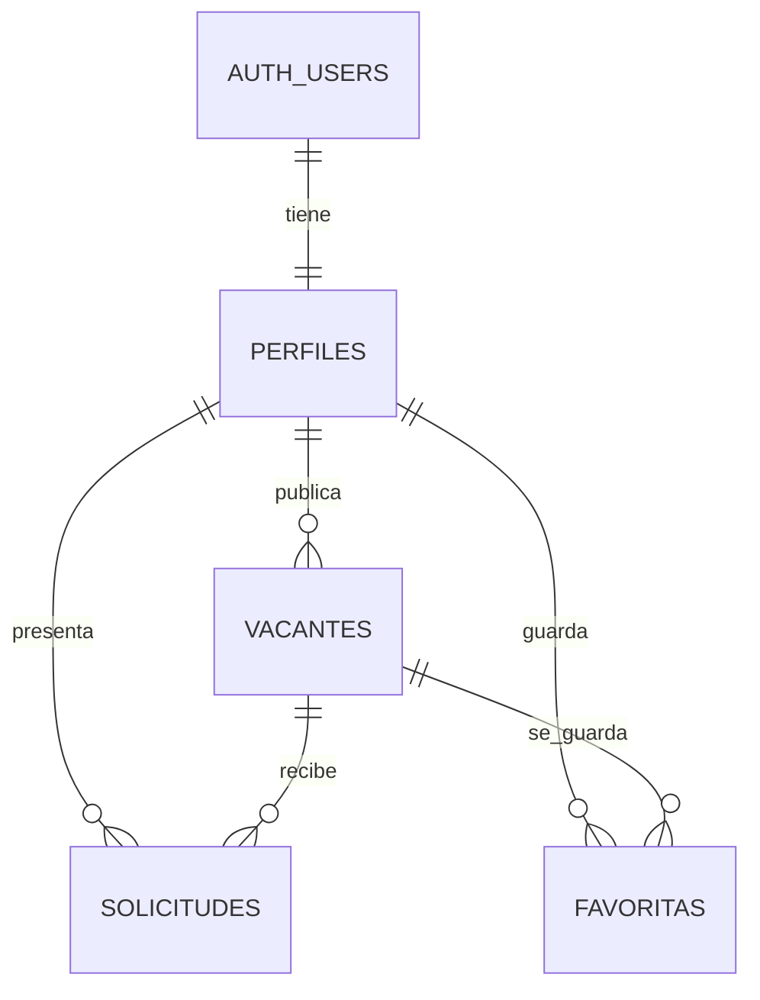

# AMAC · Bolsa de trabajo

Entrega 3 del proyecto de Desarrollo de Aplicaciones Web. La aplicación usa
React, Vite, React Router y Supabase. Conserva el diseño, el logo y los estilos
de la [Entrega 2](https://github.com/salro07co-ux/amac-web).

## Ejecutar en local

Usa Node.js 22.12 o superior.

```bash
npm install
npm run dev
```

El repositorio incluye el archivo de bloqueo de pnpm. Si usas ese gestor,
ejecuta `pnpm install` y `pnpm dev`.

### Demostración local

En desarrollo, si no hay variables de Supabase, la app carga seis vacantes
ficticias y guarda los cambios en el navegador. La sesión se mantiene por
pestaña. La demostración permite recorrer los flujos sin un servidor de base
de datos y usa una clave fija para entrar.

| Perfil | Correo ficticio |
| --- | --- |
| Candidato aprobado | candidato@amac.test |
| Candidato pendiente | pendiente@amac.test |
| Empresa | empresa@amac.test |
| Administrador | admin@amac.test |

Clave de demostración para las cuatro cuentas: `AmacDemo2026`.

### Conectar Supabase

1. En un proyecto de pruebas nuevo, ejecuta `supabase/esquema.sql` en SQL Editor.
2. Copia `.env.example` a `.env.local` y llena `VITE_SUPABASE_URL` y
   `VITE_SUPABASE_PUBLISHABLE_KEY` con los valores del proyecto. Reinicia Vite.
   Git ignora `.env.local`.
3. En la configuración de URL de Supabase Auth, permite el destino
   `http://127.0.0.1:5173/restablecer` o el equivalente con el host y puerto
   en los que abras Vite. Esto permite probar el enlace de recuperación.
4. En un proyecto nuevo, crea y confirma las cuentas ficticias en
   Authentication y ejecuta `supabase/datos-prueba.sql`. El script asigna los
   roles y carga las seis vacantes. En `amac-pruebas` ya está aplicado.

### Cuentas ficticias de Supabase

| Perfil | Correo de prueba |
| --- | --- |
| Candidato aprobado | candidato-amac@example.com |
| Candidato pendiente | pendiente-amac@example.com |
| Empresa | empresa-amac@example.com |

La contraseña de estas tres cuentas de demostración es `AMAC-Ensayo-8vK4mP26`.
Para reproducir la semilla, crea también `admin-amac@example.com` con su propia
contraseña. Estas cuentas se usan con datos ficticios. El correo integrado de
Supabase solo entrega mensajes a integrantes autorizados de la organización.
Para probar la recuperación con un buzón externo hace falta configurar SMTP.
[Documentación de Supabase sobre correo](https://supabase.com/docs/guides/auth/auth-smtp)

## Base de datos



La base usa RLS para que cada candidato consulte sus propios datos y
solicitudes, y cada empresa gestione sus vacantes y sus postulaciones
recibidas. El esquema limita los permisos para impedir que una cuenta se
cambie de rol o se apruebe por sí misma. Los logos se guardan en el bucket
`logos-empresa` bajo la carpeta de la empresa. El público consulta las
vacantes activas y un candidato conserva acceso a las vacantes a las que
ya se postuló. Una restricción `unique` impide duplicar la combinación de
vacante y candidato. Supabase Auth gestiona las contraseñas.

## Requisitos

| Requisitos | Funcionalidad | Estado |
| --- | --- | --- |
| RF-001, RF-002, RF-007 | Listado, búsqueda y filtros | Implementado |
| RF-003, RF-051 | Detalle y llamada según el canal | Implementado |
| RF-008, RF-009, RF-010 | Sesión y rutas por rol con RLS | Implementado |
| RF-011, RF-012, RF-013, RF-015 | Registro de candidatos y empresas | Implementado |
| RF-004, RF-054 | Postulación y aprobación de candidatos | Implementado |
| RF-005, RF-006 | Consulta y cancelación de solicitudes | Implementado |
| RF-019, RF-020, RF-021 | Publicación y gestión de vacantes | Implementado |
| RF-022, RF-024, RF-055 | Solicitudes recibidas, estatus, fecha y etapas | Implementado |
| RF-014, RF-017 | Edición de perfiles | Implementado |
| RF-016, RF-041 | Logo en Storage y favoritas por usuario | Implementado |
| RF-029 | Recuperación de contraseña | Verificado por correo con una cuenta del equipo de Supabase |

## Verificación local

Lighthouse dio 100/100 en accesibilidad móvil en la página de vacantes de la
compilación local. Con `amac-pruebas` también se comprobó el registro con
confirmación por correo, el inicio de sesión y el cambio de contraseña desde
el enlace de recuperación con una dirección autorizada.

Para compilar, ejecuta `npm run build` o `pnpm build`. La compilación
usa la conexión a Supabase que esté configurada en ese momento.
